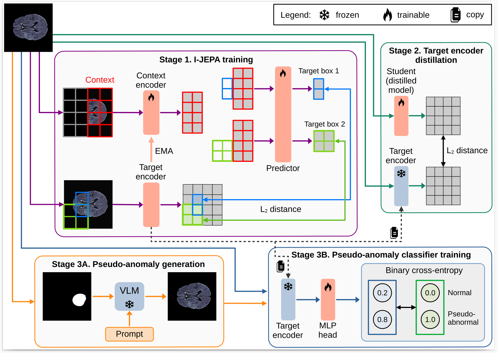

# MADJEPA - Enhanced Multi-Stage Joint-Embedding Predictive Architecture for Medical Anomaly Detection

Official implementation of the MADJEPA (Multi-Stage Joint-Embedding Predictive Architecture for Medical Anomaly Detection) paper.

## Method

**MADJEPA (Multi-Stage Joint-Embedding Predictive Architecture for Medical Anomaly Detection)** is a multi-stage training framework for unsupervised anomaly detection. Specifically, our pipeline is divided into three training stages:

* Stage 1. **Self-supervised training via [I-JEPA](https://arxiv.org/pdf/2301.08243)**
* Stage 2. **Target encoder distillation to a randomly-initialized student**
* Stage 3. **A: prompt-based pseudo-anomaly generation** and **B: normal vs. pseudo-anomaly classification**

MADJEPA predicts both image-level and pixel-level anomaly scores based on discrepancies in latent representations.

We conduct comprehensive experiments on six datasets covering various medical image domains (e.g.~MRI, OCT, X-ray, histopathology), which form the recently proposed [BMAD benchmark](https://arxiv.org/abs/2306.11876). Our method (MADJEPA), attains competitive results, ranking first or second on most datasets.




## MADJEPA training pipeline

To train the full MADJEPA pipeline, run the following command:

```bash
python3 training_pipeline.py \
 --train_ijepa_config_pattern_path="configs/train_ijepa/<DATASET_NAME>.yaml"
```

### Examples
* <i> Brats2021 (Brain MRI)</i> dataset : <code> python3 training_pipeline.py --train_ijepa_config_pattern_path="configs/train_ijepa/BraTS2021_slice.yaml"</code>

* <i> hist_DIY (Liver CT) </i> dataset : <code> python3 training_pipeline.py --train_ijepa_config_pattern_path="configs/train_ijepa/hist_DIY.yaml"</code>

* <i> RSNA (Chest X-ray) </i> dataset : <code> python3 training_pipeline.py --train_ijepa_config_pattern_path="configs/train_ijepa/ChestRSNA.yaml"</code>

This command will <b>sequentially run the three training stages</b>:
1. <b>I-JEPA training</b> (stage 1)
2. <b>Target encoder distillation</b> (stage 2)
3. <b>Pseudo-anomaly classifier</b> (stage 3)


### CLI arguments
* <code> train_ijepa_config_pattern_path</code>  = path to the I-JEPA training yaml config file. The configuration files that we used for each dataset could be found in the <code>configs/train_ijepa/</code> folder.


#### &nbsp;&nbsp;&nbsp;&nbsp;Notes

 &nbsp;&nbsp;&nbsp;&nbsp;The configs for target encoder distillation and the pseudo-anomaly classifier could be found in the folders <code> configs/train_distillation </code> and <code>configs//tsynthetic_anomaly_classifier</code> respectively.

 &nbsp;&nbsp;&nbsp;&nbsp; The command will automatically read the configuration files having the same name as <code>train_ijepa_config_pattern_path</code> for phase 2 and phase 3 from the aforementioned folders.


## Anomaly detection pipeline
For running complete anomaly detection pipeline with MADJEPA, use the following command:

```bash
python3 anomaly_detection_pipeline.py \
 --inference_config_pattern_path="configs/inference_anomaly_detection/<DATASET_NAME>.yaml" \
 --weight_distillation_test=<WEIGHT_DISTILLATION> \
 --weight_classification_test=<WEIGHT_CLASSIFICATION> \
```

### Examples
<b> Brats2021 (Brain MRI)</b> dataset :
```bash
python3 anomaly_detection_pipeline.py \
--inference_config_pattern_path="configs/inference_anomaly_detection/BraTS2021_slice.yaml" \
--weight_distillation_test=0.5 \
--weight_classification_test=0.1 
```

This command will <b>sequentially run the following steps</b>:
* Inference - stage 1 (I-JEPA training)
* Inference - stage 2 (target encoder distillation)
* Inference - stage 3 (pseudo-anomaly classifier)
* Build anomaly maps - I-JEPA 
* Build anomaly maps - distilled student
* Compute anomaly detection metrics


### CLI arguments

<code>inference_config_pattern_path</code> = path to the inference yaml config file. The configuration files that we used for each dataset could be found in the <code>configs/inference_anomaly_detection</code> folder.

<code>weight_distillation_test</code> = float number in [0, 1] range - the weight of the distilled student score in the final aggregated anomaly score

<code>weight_classification_test</code> = float number in [0, 1] range - the weight of the pseudo-anomaly classifier score in the final aggregated anomaly score


## Acknowledgements
This work is built on the code and concepts from the [I-JEPA codebase](https://github.com/facebookresearch/ijepa), [I-JEPA paper](https://arxiv.org/pdf/2301.08243).

MADJEPA was trained and evaluated on [BMAD benchmark](https://arxiv.org/abs/2306.11876).
